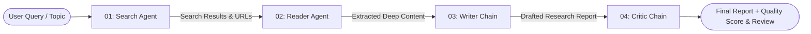

# 🔬 ResearchMind · Autonomous Multi-Agent Research System

[](https://python.org)
[](https://streamlit.io)
[](https://langchain.com)
[](https://groq.com)
[](LICENSE)

An end-to-end, autonomous **Multi-Agent Research System** that automates the complete lifecycle of investigative research: web searching, in-depth content scraping, multi-section report synthesis, and critical peer review.

---

## 🏗️ Architecture & Pipeline Flow

The system coordinates specialized autonomous agents and chains across 4 sequential stages:



### 1. 🔍 Step 1: Search Agent
- Queries the live web for recent, authoritative sources using DuckDuckGo search.
- Returns relevant page titles, URLs, and contextual snippets.

### 2. 📄 Step 2: Reader Agent
- Analyzes the initial search results to select the highest-value URL.
- Scrapes the full webpage, strips ads, navigation, and boilerplate markup, and extracts clean text content.

### 3. ✍️ Step 3: Writer Chain
- Synthesizes findings from both search snippets and deep scraped text.
- Generates a publication-ready report structured with:
  - **Introduction**
  - **Key Findings** (with detailed evidence-backed points)
  - **Conclusion**
  - **Sources & References**

### 4. 🧐 Step 4: Critic Chain
- Acts as a peer reviewer evaluating the drafted report.
- Produces a quantitative score (`X/10`), key strengths, constructive areas to improve, and a concise verdict.

---

## 📁 Project Structure

```text
Multi-agent-research-system/
├── app.py               # Streamlit interactive UI dashboard
├── pipeline.py          # Standalone CLI / Terminal execution entrypoint
├── agents.py           # Multi-agent definitions, prompts, and chains
├── tools.py            # Custom tool definitions (web search & web scraper)
├── requirements.txt    # Project dependencies
├── .env                # API keys and local environment variables (ignored)
└── README.md           # Documentation
```

---

## ⚡ Quickstart & Installation

### 1. Clone the repository
```bash
git clone https://github.com/your-username/Multi-agent-research-system.git
cd Multi-agent-research-system
```

### 2. Create and activate a Virtual Environment

**Windows (PowerShell):**
```powershell
python -m venv .venv
.\.venv\Scripts\Activate.ps1
```

**Windows (Command Prompt):**
```cmd
python -m venv .venv
.\.venv\Scripts\activate.bat
```

**macOS / Linux:**
```bash
python3 -m venv .venv
source .venv/bin/activate
```

### 3. Install dependencies
```bash
pip install -r requirements.txt
```

---

## 🔑 Environment Configuration

Create a `.env` file in the root directory:

```env
# Required for LLM inference (Get your free key from https://console.groq.com/keys)
GROQ_API_KEY=gsk_your_groq_api_key_here
```

---

## 🚀 Running the Application

### Option A: Streamlit Web Dashboard (Recommended)
Launch the interactive web application:

```bash
streamlit run app.py
```
> The dashboard will open automatically in your browser at `http://localhost:8501`.

### Option B: Terminal / CLI Mode
Run the pipeline directly in your console:

```bash
python pipeline.py
```
Enter your research topic at the prompt to watch the agents execute step-by-step with rich terminal output.

---

## 🛠️ Tech Stack

| Component | Technology | Description |
| :--- | :--- | :--- |
| **Agent Framework** | [LangChain](https://www.langchain.com/) & [LangGraph](https://www.langchain.com/langgraph) | Agent creation, tool binding, and chain orchestration |
| **LLM Inference** | [Groq](https://groq.com/) | Ultra-low latency LPU inference |
| **Web UI** | [Streamlit](https://streamlit.io/) | Modern responsive dashboard with live pipeline progress |
| **Web Search** | `duckduckgo_search` | Real-time anonymous search results without external API tokens |
| **Web Scraping** | `beautifulsoup4` & `requests` | HTML parsing and boilerplate removal |

---

## 📝 License

Distributed under the MIT License. See `LICENSE` for more information.
